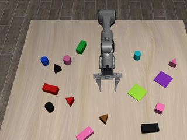
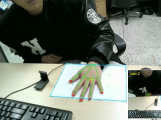
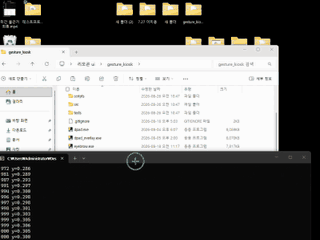
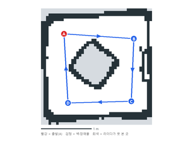
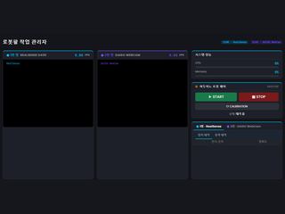
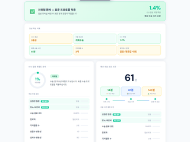

<picture>
  <source media="(prefers-color-scheme: dark)" srcset="assets/banner_dark.svg">
  
</picture>

## 소개

- 계명대학교 컴퓨터공학전공, **LAB-1309 학부연구생**입니다.
- 웹캠으로 사람의 손과 얼굴을 읽어 기계를 움직이는 일을 주로 했습니다. 키오스크 입력 장치(기업 인턴), 자율주행 로봇, 비전 검사 설비, 연구실 로봇팔 원격조종이 그런 작업입니다.
- 지금은 말로 일을 시키는 로봇팔 AI(VLA)가 **일하는 도중 새 명령을 받아도 처음으로 돌아가지 않고 이어서** 하게 만드는 연구를 합니다.
- 민원발급기나 라즈베리파이처럼 성능이 모자란 기계에서 돌아가게 만드는 일에 가장 오래 매달렸습니다.

## 대표 작업

<table>
<tr>
<td align="center" valign="top" width="33%">
 
<b><a href="https://github.com/kakabab12/LAB-1309">말로 시키는 로봇팔 AI 연구</a></b> 
일하는 도중 새 명령에도 이어서 · SmolVLA <code>2026 학부연구생</code>
</td>
<td align="center" valign="top" width="33%">
 
<b><a href="https://github.com/kakabab12/My_portfolio/tree/main/2026/07.%20학부연구생%20-%20웹캠%20PiPER%20원격조종">웹캠으로 실물 로봇팔 원격조종</a></b> 
손을 재서 연구실 PiPER 가 따라 집음 <code>2026 학부연구생</code>
</td>
<td align="center" valign="top" width="33%">
 
<b><a href="https://github.com/kakabab12/My_portfolio/tree/main/2026/01.%20광명테크%20인턴%20-%20배리어프리%20키오스크">배리어프리 키오스크 입력 장치</a></b> 
고개로 커서를 옮기고 입을 벌려 클릭 <code>2026 기업 인턴</code>
</td>
</tr>
<tr>
<td align="center" valign="top" width="33%">
 
<b><a href="https://github.com/kakabab12/My_portfolio/tree/main/2026/02.%20SW파일럿%20-%20TurtleBot3%20자율주행%20로봇">TurtleBot3 자율주행 로봇</a></b> 
SLAM 지도 위 순찰 · ROS 2 <code>2026 팀 프로젝트</code>
</td>
<td align="center" valign="top" width="33%">
 
<b><a href="https://github.com/kakabab12/My_portfolio/tree/main/2026/03.%20캡스톤%20-%20스마트팩토리%20비전검사">스마트팩토리 비전 검사</a></b> 
카메라 2대 병렬 추론 → 로봇팔 <code>2026 캡스톤</code>
</td>
<td align="center" valign="top" width="33%">
 
<b><a href="https://github.com/kakabab12/My_portfolio/tree/main/2026/04.%20메디컬%20머신러닝%20대회">수술 위험도 예측 AI</a></b> 
ICU 위험·수술시간 예측과 근거 설명 <code>2026 대회</code>
</td>
</tr>
</table>

그림을 누르면 해당 프로젝트로 갑니다. 다른 작업까지 모두 보려면 → <a href="https://github.com/kakabab12/My_portfolio"><b>My_portfolio</b></a>

## 기술

배지를 누르면 그 기술이 무엇이고 어디에 왜 썼는지 볼 수 있습니다 → [**기술 용어집**](https://github.com/kakabab12/My_portfolio/blob/main/기술_용어집.md)

## 걸어온 길

| 언제 | 무엇을 |
|:-:|---|
| `2026.09 ~` | **계명대 LAB-1309 학부연구생**: 로봇팔 AI(SmolVLA) 작업 전환 연구, 실물 PiPER 웹캠 원격조종 |
| `2026.08` | SW 파일럿 팀 프로젝트: TurtleBot3 자율주행 로봇 (ROS 2) |
| `2026.07 ~ 09` | **(주)광명테크 인턴**: 손을 쓰기 어려운 분을 위한 키오스크 입력 장치 (웹캠으로 고개 · 입 인식) |
| `2026.05` | 메디컬 머신러닝 대회: 수술 위험도 예측 AI |
| `2026 상반기` | 캡스톤 2단계: 스마트팩토리 비전 검사 (Jetson · TensorRT) |
| `2025 2학기` | 캡스톤 1단계: 라즈베리파이 선별 시스템 (YOLOv8) |

## 논문

- **ACT 모방학습 기반 스마트 팩토리 순차 적재에서 시연 일관성의 영향 분석** 
  이지용, 고병철 · 대한전자공학회 2026 추계학술대회 학부생 논문경진대회 (포스터 발표 2026.11.28)

## 연락처

<table>
<tr><td><b>이메일</b></td><td><a href="mailto:yeez0612@naver.com">yeez0612@naver.com</a></td></tr>
<tr><td><b>전화</b></td><td>010-4803-0454</td></tr>
<tr><td><b>연구 기록</b></td><td><a href="https://github.com/kakabab12/LAB-1309">LAB-1309</a></td></tr>
<tr><td><b>포트폴리오</b></td><td><a href="https://github.com/kakabab12/My_portfolio">My_portfolio</a></td></tr>
</table>
